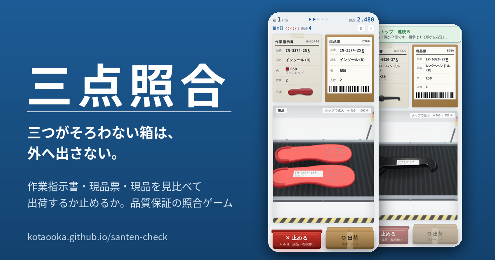
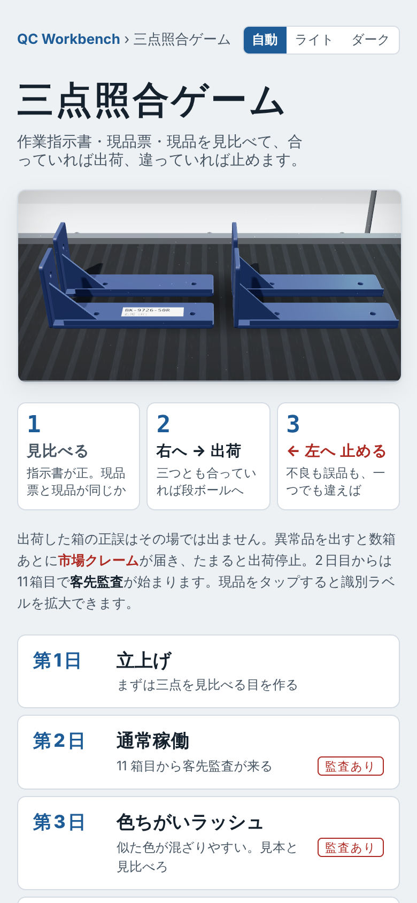
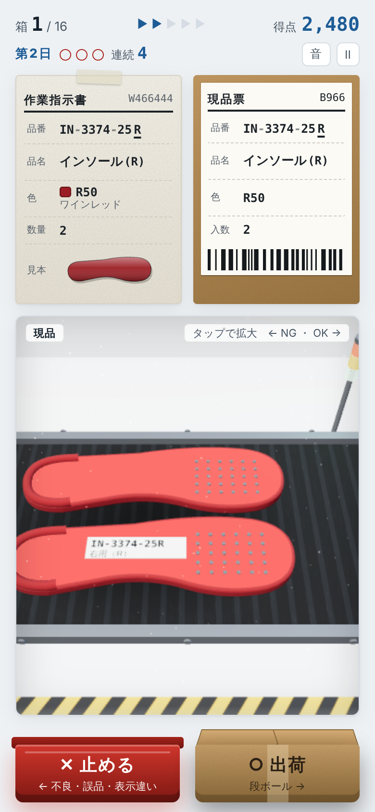
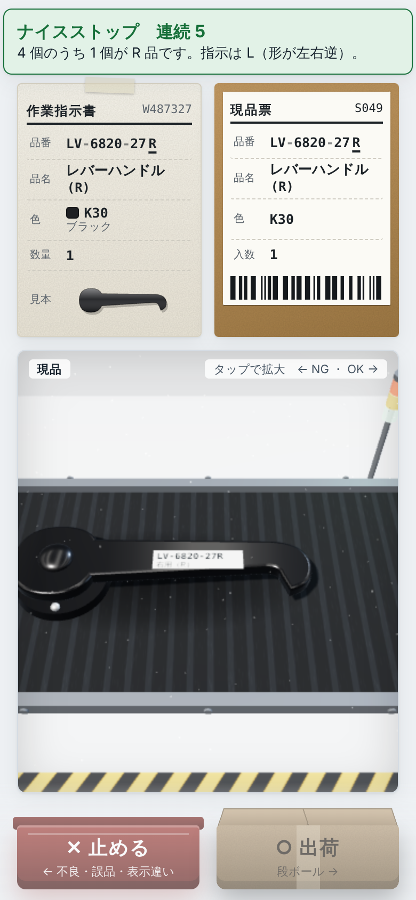
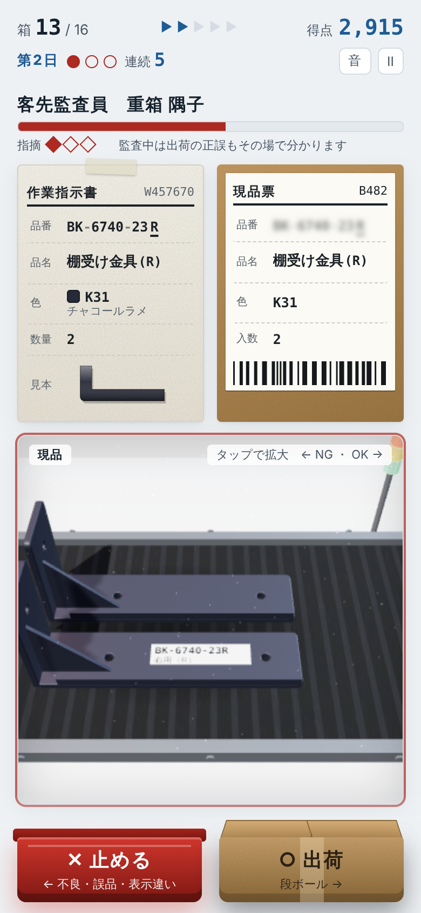
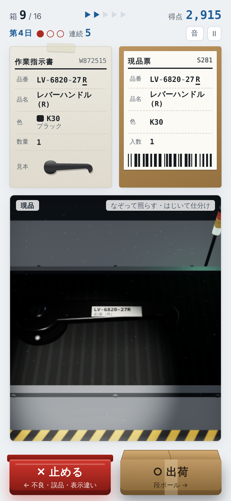

# 三点照合ゲーム（santen-check）

**作業指示書・現品票・現品。三つが揃わぬ箱を、ひとつも外へ出すな。**
コンベアを流れてくる箱を見比べて、合っていれば出荷、違っていれば止める。品質保証の「三点照合」を、指先ひとつで仕分けるゲームにしました。

### ▶ [いますぐ遊ぶ](https://kotaooka.github.io/santen-check/)

- ブラウザで開くだけ。インストール・登録は要りません（スマホでも PC でも）
- 記録は端末の中に保存します。どこにも送りません
- 画面の字体は Google Fonts から読み込むため、開いたときに Google のサーバーへ接続します。入力したデータは送りません
- 色と字体は QC Workbench のほかのツールとそろえています。表示はタイトル画面で「自動・ライト・ダーク」を切り替えられます
- ホーム画面に追加すると、アプリのように起動できます。一度開けば、電波のない所でも遊べます
- 品物は 3D で描きます。3D が使えない端末では 2D の絵で遊べます

## 📸 こんなゲームです

<table>
<tr>
<td align="center"> 7日間を順に解放</td>
<td align="center"> 指示書と現品票の行は横一列</td>
<td align="center"> 4個のうち1個だけ左右違い</td>
</tr>
<tr>
<td align="center"> 11箱目からは客先監査</td>
<td align="center"> 夜勤は懐中電灯で照らす</td>
<td></td>
</tr>
</table>

## 🧾 30 秒でわかる遊び方

1. **見比べる。** 指示書が正です。現品票（箱のラベル）と現品が、指示書と同じかを確かめます
2. **合っていれば、右へはじいて出荷。** 現品が段ボールに入ります
3. **一つでも違えば、左へはじいて止める。** 品番・色・形・数量・左右、異品や異物の混入も。不良品も誤品（品物は良品だが指示と違う）も、表示の誤りも止めます

流れてくる品物は、インソール・レバーハンドル・棚受け金具・スマホケース・弁当箱・マグカップの6種類です。左右のある品（インソール・レバーハンドル・棚受け金具）は、L品とR品の取り違えにも注意します。

現品はコンベアで流れてきます。右端まで流れるとライン停止です。続けて判定するとライン速度と得点の倍率が上がります。

**出荷した箱が正しかったかは、その場では分かりません。** 異常品を出荷すると、数箱あとに「市場クレーム」が届きます。たまると出荷停止です。

## 🎮 操作

| やること | スマホ | PC |
|---|---|---|
| 出荷（段ボールへ） | 現品を右へはじく／段ボールをタップ | → |
| 止める（不良・誤品・表示違い） | 現品を左へはじく／赤い箱をタップ | ← |
| 識別ラベルを拡大（ルーペ） | 現品をタップ | 現品をクリック |
| 見ている項目に印を付ける | 指示書・現品票の行をタップ | 行をクリック |
| 一時停止 | 右上の II | Esc / P |
| 判定の表示を閉じる | 表示をタップ | Enter / Space |

アプリを切り替えると自動で一時停止します。

## 📅 7日間

| 日 | 名前 | とくちょう |
|---|---|---|
| 1 | 立上げ | 最初の3箱は練習。監査なし |
| 2 | 通常稼働 | 11 箱目から客先監査が来る |
| 3 | 色ちがいラッシュ | 似た色が混ざりやすい |
| 4 | 夜勤 | 検査台の照明が切れている。なぞって照らし、はじいて仕分け |
| 5 | 繁忙期 | ライン速度 3 から始まる |
| 6 | 新人の箱詰め | 異常が多い |
| 7 | 客先監査週間 | クレーム 2 件で出荷停止。監査員は本気 |

1日は16箱。2日目からは、11箱目で **客先監査** が始まります。監査中は出荷の正誤もその場で分かります。正しい判定で監査員の疑いを削りきれば合格、指摘 3 回で不合格です。

## 💡 コツ

- **行を横に見る。** 指示書と現品票の同じ項目は、画面上で同じ高さに並んでいます
- **品番の最後の文字を見る。** 左右のある品は、品番の末尾（下線）が R か L です。品番の頭の2文字は品物の分類（IN＝インソール、MG＝マグカップなど）
- **個数を数える。** 2個以上入りの箱は、奥の1個だけ違うことがあります
- **異常が来ない時間ほど気をつける。** 正常が長く続いたあとに来ます
- **色と形は見本で見る。** 指示書の見本（色と形の絵）と現品を見比べると、似た色や左右の取り違えに気づきやすくなります
- **似た色に注意。** ホワイトとシルバー、ブラックとチャコールラメ

## ❓ よくある質問

- **お金はかかる？** かかりません。広告もありません
- **音が出ない** 右上の「音」ボタンを確認してください。iPhone はマナーモードだと鳴らないことがあります
- **重い・熱くなる** 重い端末では自動で画質を下げます。それでも重いときは、他のアプリを閉じてください
- **データは？** 進み具合と自己ベストは、この端末のブラウザの中だけに保存します
- **新しくしたのに古いまま** 一度閉じて開き直してください（オフライン用に前の版が残っていることがあります）

## ライセンス

MIT License
